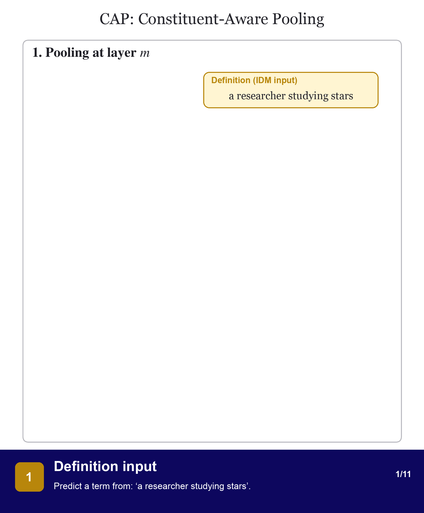

# Where Do LLMs Compose Meaning? A Layerwise Analysis of Compositional Robustness
[](https://www.python.org/downloads/)
[](https://www.gnu.org/licenses/gpl-3.0)


This repository contains the code for the paper "Where Do LLMs Compose Meaning? A Layerwise Analysis of Compositional Robustness" (EACL 2026).

## Overview

This project investigates how Large Language Models (LLMs) compose meaning across different layers by analysing their robustness to activation grouping at various granularities.

### Constituent-Aware Pooling (CAP)
We introduce **Constituent-Aware Pooling (CAP)**, an intervention that pools token representations into linguistic constituents, such as words or phrases, at selected model layers. CAP combines token-level activations using mean, sum, max, or last-token pooling.



## Setup

Use the provided `environment.yml` with Python 3.11. From the repository root:

```bash
conda env create -f environment.yml
conda activate LLMs_grouping
python -m spacy download en_core_web_sm
python -c "import benepar; benepar.download('benepar_en3')"
```

The final two commands install the English parsing models used by `src/nlp_setup.py`. Model weights are downloaded on first use; the required downloads and memory depend on the model selected for an experiment.

## Usage


The main script `activation_grouping_main.py` supports various experimental configurations:

The model and data preparation settings must match. To evaluate another layer, change `--start_layer` and run the command again. For phrase-level pooling, use `--granularity token_to_phrases`; `random` provides a grouping control.

| Argument | Purpose |
| --- | --- |
| `--model_name` | Model to evaluate; `GPT2` is the default. |
| `--task_type` | `inverse_dictionary`, `synonyms`, `hypernyms`, `input_reconstruction`, or `exact_sequence_autoencoding`. |
| `--supervision_type` | `original` or `fine-tuned`. Fine-tuned runs also require `--model_path`. |
| `--data_path` | Path to the processed JSON from `src/model_testing.py`. |
| `--start_layer` | Layer at which the intervention begins. |
| `--granularity` | `token_to_words`, `token_to_phrases`, or `random`. |
| `--grouping_protocol` | `mean`, `sum`, `max`, or `last_token`. |
| `--component` | Optional activation component or hook name; omit it for the default component selection. |
| `--k` | Number of top predictions used for the task metric. |

### Control variants

Add `--norm_preserve` to preserve activation norms after pooling. Add `--broadcast_cap` to broadcast each pooled value back to its original token positions and preserve sequence length. Run these controls separately from the sequence-compressing CAP configuration above so their outputs are easy to compare.

## Outputs

The script writes a text log under `results/{model_name}/{task_type}/` and a JSON file under one of these folders:

| Granularity | JSON folder |
| --- | --- |
| `token_to_words` | `tw_logs/` |
| `token_to_phrases` | `tp_logs/` |
| `random` | `ran_logs/` |

The JSON contains per-batch clean and grouped metrics, grouped predictions, labels, sequence lengths, compression ratios, layer and pooling settings, followed by a summary record. Filenames include the model, task, seed, pooling rule, and start layer.

Results are saved in two formats:
- **Log files**: Detailed execution logs in `results/{model_name}/{task_type}/`
- **JSON files**: Structured metrics and predictions in `results/{model_name}/{task_type}/{granularity}_logs/`

## Repository layout

```text
.
├── ReadMe.md
├── environment.yml
├── activation_grouping_main.py     # CAP intervention and evaluation
├── cap_method.gif              # Method animation
├── src/
│   ├── dataset.py                  # Task prompts and tokenisation
│   ├── exract_definitions.py       # WordNet definition preparation
│   ├── extract_synonyms_hypernyms.py
│   ├── model_testing.py            # Clean-run filtering
│   ├── model_finetuning.py
│   ├── metrics.py
│   ├── nlp_setup.py
│   └── utils.py
├── data/                            # Generated locally
└── results/                         # Generated locally
```

## Experiments

The code supports analyzing:
- **Component-wise effects**: MLP, attention (Q/K/V/Z, scores, patterns), residual stream
- **Layer-wise progression**: Start interventions from different layers
- **Granularity levels**: Word-level, phrase-level, or random grouping
- **Pooling strategies**: Mean, sum, max, or last-token aggregation

## Citation

If you use this code in your research, please cite:

```bibtex
@inproceedings{aljaafari-etal-2026-llms,
    title = "Where Do {LLM}s Compose Meaning? A Layerwise Analysis of Compositional Robustness",
    author = "Aljaafari, Nura  and
      Carvalho, Danilo  and
      Freitas, Andre",
    editor = "Demberg, Vera  and
      Inui, Kentaro  and
      Marquez, Llu{\'i}s",
    booktitle = "Proceedings of the 19th Conference of the {E}uropean Chapter of the {A}ssociation for {C}omputational {L}inguistics (Volume 1: Long Papers)",
    month = mar,
    year = "2026",
    address = "Rabat, Morocco",
    publisher = "Association for Computational Linguistics",
    url = "https://aclanthology.org/2026.eacl-long.214/",
    doi = "10.18653/v1/2026.eacl-long.214",
    pages = "4622--4646",
    ISBN = "979-8-89176-380-7",
    abstract = "Understanding how large language models (LLMs) process compositional linguistic structures is integral to enhancing their reliability and interpretability. We present Constituent-Aware Pooling (CAP), a methodology grounded in compositionality, mechanistic interpretability, and information theory that intervenes in model activations by pooling token representations into linguistic constituents at various layers. Experiments across eight models (124M-8B parameters) on inverse definition modelling, hypernym and synonym prediction reveal that semantic composition is not localised to specific layers but distributed across network depth. Performance degrades substantially under constituent-based pooling, particularly in early and middle layers, with larger models showing greater sensitivity. We propose an information-theoretic interpretation: transformers' training objectives incentivise deferred integration to maximise token-level throughput, resulting in fragmented rather than localised composition. These findings highlight fundamental architectural and training constraints requiring specialised approaches to encourage robust compositional processing."
}
```

## License

This project is licensed under the licensed under the GPLv3 License - see the [LICENSE](LICENSE.txt) file for details.

## Contact
For questions or issues regarding this code, or for paper-related inquiries, please:
- Open an issue in this repository
- Contact: nuraaljaafari@gmail.com